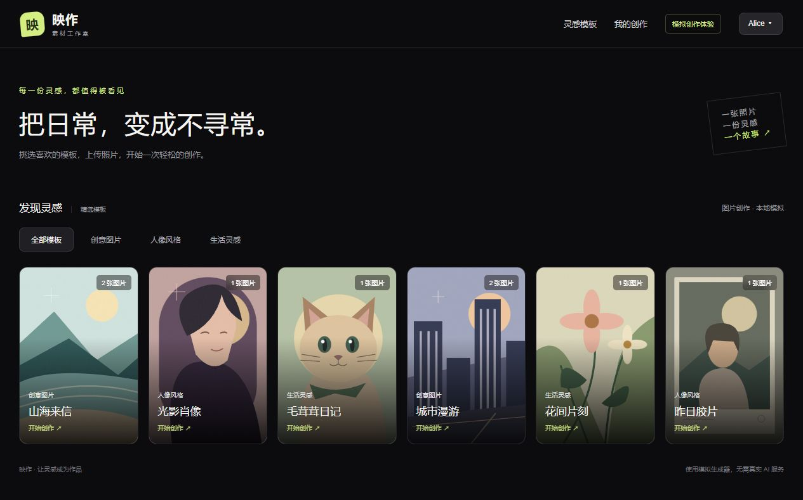

# 映作 · 素材工作室

独立运行的素材制作演示网站：浏览模板 → 上传图片 → 提交任务 → Java 后台处理 → 查看个人历史与结果。界面为中文，采用参考图的暗色卡片、分类列表及左侧制作/右侧记录布局，小屏上下排列。

**制作不调用真实 AI。** 模拟结果是第一张上传图片的独立持久化副本；通过可调耗时和指定阶段失败，演示完整异步业务。原题以三天描述背景，用户已确认不按天限时，以实现和验证为准。

文档更新时间：2026-10-30（wangqingkai/hfut）。M0～M7 工程实施与本地验收已完成；最终对外提交前仍需用户填写 AI 工作流。`EADME.md` 为本文件的跳转入口。



## 1. 启动项目

需要已启动的 Docker Engine / Docker Desktop（Linux 容器）及 Compose v2。宿主机不需要安装 Node、Java、Maven 或 MySQL。首次构建需要能访问 npm、Maven Central 和基础镜像仓库；已固定依赖版本及镜像 digest。建议给 Docker 至少 4 GiB 可用内存，构建检查串行执行；实际需求受同时运行的其他容器影响。

在源码根目录执行：

```sh
docker compose up --build -d --wait
docker compose ps
```

打开 <http://localhost:3000>，选择 Alice 或 Bob，即可开始制作。数据库首次启动后由 Java 的 Flyway 自动执行 V1～V4 结构和种子迁移，无需手动导入 SQL。

默认配置是明确的本地演示值，**不含真实凭据**；无需 `.env` 也可以启动。需要修改端口、密码或耗时时，先复制 `.env.example` 为 `.env`（PowerShell：`Copy-Item .env.example .env`；POSIX shell：`cp .env.example .env`），编辑后重新启动。已有 MySQL 卷中的账户密码不会随 `.env` 修改自动变更，首次建库应先确定配置。

本项目 Compose 名称为 `yingzuo`，默认仅开放 `127.0.0.1:3000`，Java 和 MySQL 不开放宿主机端口。容器内部链路：

```text
浏览器 → Next.js :3000 /api/** → Java backend:8080 → MySQL db:3306
                                           └→ /app/data 文件卷
```

Next.js 只转发请求，Java 负责业务、会话、文件访问及持久化。`mysql-data` 保存数据库，`asset-data` 保存上传和结果。重建容器会保留这两个卷；普通停止用 `docker compose stop`，重新启动用 `docker compose up -d --wait`。不要在需要保留演示记录时执行 `down --volumes`。

## 2. 技术版本与取舍

| 层次 | 实际锁定版本 / 方案 | 取舍 |
| --- | --- | --- |
| 前端运行时 | Node 22.23.4 / npm 10.9.9 | Docker 固定镜像，npm ci + 锁文件，严格 peer 校验 |
| 前端 | Next.js 16.4.3 App Router、React/DOM 19.3.1、TypeScript 5.9.3 | 遵守指定栈；严格类型检查、lint 与构建分别执行 |
| 样式 | 全局 CSS 与设计变量 | 无 UI 框架成本，语义按钮、原生 dialog、焦点和响应式由项目实现 |
| 服务端状态 | TanStack Query 5.105.0 | 缓存按用户/任务隔离；短期上传草稿保存在 React 组件，不引入 Redux |
| 前端检查 | ESLint 9.39.5、eslint-config-next 16.4.3；Vitest 5.0.5、RTL 16.3.3、MSW 3.0.3、jsdom 30.1.3 | 受控响应验证并发及请求异常；不要求端到端框架 |
| Java | Java 21；构建 Temurin 21.0.9+10，运行 21.0.12.1+1 | 均为 Java 21；项目不使用宿主机 Java 11 |
| 后端 | Spring Boot 3.5.16、MyBatis Starter 3.0.5 / Core 3.5.19、Maven 3.9.11 | Starter 3.0 系列适配 Boot 3.5，避免混用 Boot 4 系列依赖 |
| 数据库 | MySQL 8.4.11、Connector/J 9.7.0、Flyway 11.7.2 | 真正的 MySQL 集成验证；迁移脚本随源码版本管理 |
| Java 测试 | JUnit Jupiter 5.12.2、Mockito、Failsafe 3.5.6 | 步骤顺序/失败中断单元测试 + MySQL 接口集成测试 |
| 异步 | 单实例 Java 串行工作器 + MySQL 队列 | 请求只建档；关闭页面不影响执行；无 Redis/MQ 成本，吞吐和扩容能力有限 |
| 通知 | 未结束任务约 2 秒轮询 | 简单可恢复，无 SSE/WebSocket 连接维护；有短暂状态延迟 |
| 文件 | 本地 Docker 命名卷，私有 HTTP 预览 | 无付费服务；需要数据库和文件配套备份，不能直接多副本共享 |
| 交付 | Compose、多阶段镜像、GitHub Actions | 安装、测试、构建、应用均可在容器隔离环境运行 |

依赖兼容性以锁文件、POM、镜像及实际容器检查为证据。官方依据：[Next.js 16](https://nextjs.org/docs/app/guides/upgrading/version-16)、[Boot 3.5](https://docs.spring.io/spring-boot/3.5/system-requirements.html)、[MyBatis Starter](https://github.com/mybatis/spring-boot-starter)、[TanStack Query](https://tanstack.com/query/v5)。

已知工具链提示：ESLint 9 已停止上游维护，但所选 React/import/a11y 插件 peer 范围不接受 ESLint 10，因此固定兼容版本；Flyway 对 MySQL 8.4 给出“新于已测试版本”提示（[上游问题](https://github.com/flyway/flyway/issues/4168)），真实迁移和集成测试通过；Mockito 在 Java 21 有动态 agent 提示。没有通过忽略测试失败掩盖这些提示。

## 3. 项目结构与配置

```text
frontend/                       Next App Router、组件、API/查询逻辑与测试
backend/src/main/java/studio/yingzuo/
  template/ identity/ asset/    模板、演示会话与素材
  task/                        受理、短事务、流水线、独立工作器
backend/src/main/resources/
  db/migration/V1～V4           MySQL 结构及初始化数据
  demo/*.svg                   六份本地模板封面
backend/src/test/              流水线单元与真实 MySQL 集成测试
demo-inputs/                   可直接上传的 PNG / JPEG 示例
tools/                        API 验证、强制重启验证、示例图片生成源码
docs/                         M0～M7 验证记录、素材来源、部署回滚说明
.github/workflows/ci.yml       push / pull_request 容器流水线
compose.yaml / .env.example    启动、检查、非敏感配置
```

| 配置项 | 默认值 / 使用范围 |
| --- | --- |
| `WEB_PORT` / `WEB_BIND_ADDRESS` | `3000` / `127.0.0.1`，宿主机入口 |
| `JAVA_API_ORIGIN` | `http://backend:8080`，**Next 镜像构建期** rewrite 地址；修改后要重新 build frontend |
| `MYSQL_DATABASE` / `MYSQL_USER` | `material_studio` / `material_app`，MySQL 首次初始化及 Java 连接 |
| `MYSQL_PASSWORD` / `MYSQL_ROOT_PASSWORD` | `.env.example` 中明确的本地演示占位值；Java 仅使用应用账户 |
| `DEMO_MODE` | `true`；演示账户登录及逐任务模拟参数覆盖开关 |
| `SESSION_TTL_SECONDS` | `86400`，会话有效秒数；配置正整数 |
| `SESSION_COOKIE_SECURE` | `false` 适配本地 HTTP；部署到 HTTPS 时改为 `true` |
| `SIMULATION_ASSET_CHECK_MS` | `2000`，素材检查默认延迟 |
| `SIMULATION_GENERATE_MS` | `2000`，模拟生成默认延迟 |
| `SIMULATION_FINALIZE_MS` | `2000`，结果整理默认延迟 |

延迟范围为整数 0～30000 毫秒。默认值由 Java 读取，任务提交时保存配置快照。Compose 将数据库配置映射为 Java 的 `SPRING_DATASOURCE_URL/USERNAME/PASSWORD`；文件目录映射为 `STORAGE_ROOT=/app/data`。如自行编排 Java 容器，需提供这些配置；连接 URL 为 `jdbc:mysql://db:3306/material_studio?connectionTimeZone=UTC`。

实际 `.env` 不入库，数据库配置不会进入浏览器 bundle。Java 运行堆上限 512 MiB，并设置两逻辑 CPU 视图；这不是容器总内存上限。前端构建堆为 768 MiB，构建与测试并发限制为 2。`test-db` 使用独立临时数据库，停止后不保留测试数据。

模板为 3 类、6 个，覆盖单图与双图。SVG 封面随 Java 镜像提供；上传示例是 `demo-inputs/sample-1.png`、`sample-2.png`、`sample-1.jpg`，无需下载或生成。上传支持 JPEG/PNG，每张不超过 5 MiB、2400 万像素；服务端检查真实格式、可解码性、尺寸、素材归属和模板参数，不只信任扩展名。

## 4. 主要接口

浏览器均从同源 `/api` 访问；时间保存为 UTC，返回 ISO 8601，前端按本地时区展示。

| 方法与路径 | 请求 / 响应 | 身份 |
| --- | --- | --- |
| GET `/api/system` | `{name,version,status}` | 公开 |
| GET `/api/templates/categories` | 分类字符串数组 | 公开 |
| GET `/api/templates?category=创意图片` | 模板数组；省略分类返回全部 | 公开 |
| GET `/api/templates/{id}` | 单个模板，不存在 404 | 公开 |
| GET `/api/templates/{id}/cover` | 本地 SVG 封面 | 公开 |
| GET `/api/demo-users` | `[{id,demoKey,displayName}]` | 演示模式 |
| POST `/api/session` | `{demoUserKey:"alice"}`；返回用户，设置会话 Cookie | 演示模式 |
| GET `/api/session` | 当前用户；无有效会话 401 | 当前会话 |
| DELETE `/api/session` | 注销当前会话，204 并清除 Cookie | 当前 Cookie |
| POST `/api/assets` | multipart `file`、`templateId`；201 `{id,previewUrl,mimeType,sizeBytes}` | 必须登录 |
| GET `/api/assets/{id}/content` | 上传或结果图片，仅归属用户可读 | 必须登录 |
| POST `/api/tasks` | 创建请求如下；202 返回任务快照及 Location | 必须登录 |
| GET `/api/tasks/{id}` | 单个任务及步骤 | 必须登录 |
| GET `/api/tasks` | 当前用户全部历史，按创建时间降序 | 必须登录 |

模板字段示例：

```json
{
  "id": "demo-postcard", "title": "山海来信", "category": "创意图片",
  "coverUrl": "/api/templates/demo-postcard/cover",
  "description": "上传两张图片，模拟制作明信片",
  "requiredImageCount": 2,
  "acceptedMimeTypes": ["image/jpeg", "image/png"], "maxFileSizeBytes": 5242880
}
```

创建任务示例（`assetIds` 必须替换为当前用户真实上传返回的 ID）：

```json
{
  "templateId": "demo-portrait",
  "assetIds": ["实际上传返回的素材ID"],
  "clientRequestId": "9c2ea801-01c1-46e7-a442-5e1701e74643",
  "simulation": {
    "failAtStage": null,
    "stageDelayMs": {"ASSET_CHECK": 2000, "GENERATE": 8000, "FINALIZE": 2000}
  }
}
```

`simulation` 可省略。`failAtStage` 为 null / `ASSET_CHECK` / `GENERATE` / `FINALIZE`；耗时 Map 可只覆盖部分阶段。`DEMO_MODE=false` 时拒绝传入模拟覆盖配置，也不开放演示登录，**不等于已经提供生产身份体系**。

任务快照字段：`id`、`templateId`、`templateTitle`、`status`、`stage`、`createdAt`、`startedAt`、`finishedAt`、`resultUrl`、`failedStage`、`errorCode`、`errorMessage`、`version`、`steps`。未开始/未完成字段可为 null；每个 step 含 `taskId/stage/status/startedAt/finishedAt/errorMessage`。

错误统一为 `{code,message,traceId}`。400 参数错误、401 未登录、403 演示功能关闭、404 不存在或无权访问、409 幂等参数冲突、413 文件过大、415 图片类型/内容不符、500 服务异常。不会向客户端暴露服务器文件路径或堆栈。

## 5. 后台流程与前端状态

```text
POST 校验 + 短事务创建 QUEUED → 返回 202 / 任务 ID
  Java 独立工作器约每 500ms 领取最早任务（串行，CAS 领取）
    → RUNNING / ASSET_CHECK 素材检查
    → RUNNING / GENERATE 模拟生成
    → RUNNING / FINALIZE 结果整理
    → SUCCEEDED / resultUrl
  任一步异常 → FAILED / failedStage / errorCode / errorMessage → 不再执行后续步骤
```

- 任务、阶段、失败原因和结果均持久化至 MySQL；`task_steps` 保存独立执行边界。延迟和文件操作在短事务外执行，不用一个长事务包住全部处理。
- 成功结果关联、最后一步完成及任务成功在同一事务提交。所有 GET 接口只查询，不推进执行；终态不会因查询退回处理中。
- 幂等键为用户 + `clientRequestId`（UUID），相同内容重试返回同一任务；不同内容复用键返回 409。前端提交请求失败重试沿用键，受理成功后下一次创作用新键。
- 上传中、提交请求中、等待/处理、成功、业务失败分别表达。202 后释放提交按钮，允许继续创建，后台任务不依赖页面存活。
- TanStack Query 缓存键包含用户和任务 ID；按 version 合并，拒绝旧响应及终态回退。只自动跟踪未结束任务，终态/无任务停止轮询。
- 查询暂时失败保留已有任务信息，显示“恢复查询”，不把任务改为 FAILED；恢复按钮重新读取真实状态。身份查询 503 保留已知身份，401 才清除身份。
- 切换用户取消旧查询、清理个人缓存及上传草稿；离开任务页面取消请求。刷新从 Java 恢复历史并继续跟踪未结束任务。
- **重启边界已验证**：启动时将遗留 RUNNING 收敛为 FAILED / PROCESS_INTERRUPTED，保留中断阶段；QUEUED 继续执行；终态及文件保留。不支持从阶段中间续跑，仅支持单个 Java 实例。

数据表为 `users`、`sessions`、`templates`、`assets`、`tasks`、`task_assets`、`task_steps`，另有工程元数据和 Flyway 历史表。任务按用户/创建时间及状态/创建时间建立索引；幂等键有唯一约束，素材和任务归属由服务端会话确定。真实字段以 `backend/src/main/resources/db/migration/` 为准。

### 5.1 后台自动重试的取舍

**当前未实现制作任务或阶段的自动重试。** 任一步执行异常后，保存失败阶段和原因，将任务置为 FAILED，并停止后续步骤。工作器下一轮继续领取 QUEUED 任务，不会重新执行已失败任务；重启后的中断任务也不会自动重做。这属于题目允许讨论取舍的可选扩展，本次交付保留这一边界。

暂不实现的原因：当前生成器不调用真实外部 AI 服务，没有外部请求超时、限流等需要重试的业务依赖；指定阶段失败是可重复的模拟配置，直接重试仍会失败。失败立即可见，便于验证步骤中断、原因持久化和多任务隔离，也避免无效重试长时间占用串行队列。代价是瞬时文件或数据库异常不会通过任务重试自行恢复；数据库无法写入时仍按第 10 节说明处理。

任务受理幂等只保证重复提交不会创建多个任务，不保证每个阶段可以安全重复执行。增加后台重试前，还需处理重复生成文件、重复保存阶段结果等副作用，因此不能简单地在流水线外套一层重试循环。

如后续接入真实服务，可作为独立扩展实现：区分可重试的临时网络/限流错误与不可重试的参数、权限、素材损坏及指定模拟失败；为阶段建立幂等操作和持久化结果检查点，记录尝试次数、下次执行时间及每次错误；设置有限次数（例如最多 3 次尝试）、指数退避和抖动，由调度器在终态前安排下一次尝试，耗尽次数后才置 FAILED。已保存的成功/失败终态保持不变。这些机制是后续设计方向，当前没有实现或验证。

前端“恢复查询”只重新读取任务状态，不触发后台重试；提交请求异常后沿用同一 `clientRequestId` 的重试属于幂等受理，也不会重新执行已有任务。当前没有失败任务的手动重做入口。

## 6. 演示操作

1. **成功**：选择 Alice → 光影肖像 → 上传 `sample-1.png` → 开始制作；依次看到三阶段和成功结果，点击作品预览。
2. **指定阶段失败**：展开“演示设置”，勾选模拟参数，选择失败阶段并提交。分别选择三阶段可重复复现；卡片显示失败阶段/原因，后续阶段不执行。
3. **调整耗时/多任务**：模拟生成设置为 15000 毫秒，连续提交两次；第一个处理、第二个等待，各自结束。也可在 `.env` 修改三个默认耗时并重建后端容器配置。
4. **刷新恢复/离开**：任务处理中刷新或返回模板列表，稍后打开“我的创作”；记录由 Java 恢复，后台持续执行。上传草稿不做刷新恢复。
5. **个人隔离**：Alice 创建记录后，通过顶部账户窗口切到 Bob，应只看到 Bob 的记录；再切回 Alice 恢复 Alice 历史。直接读取他人任务或图片返回 404。
6. **查询请求异常**：保持制作页打开，在任务处理时运行 `docker compose stop frontend`，等待页面提示查询失败；Java 仍执行。运行 `docker compose up -d --wait frontend` 后点“恢复查询”，读取最终状态。无需刷新整个页面。

程序化成功、指定失败、幂等、跨用户和终态演示：

```sh
docker compose --profile checks run --rm api-check
```

该脚本会给 Alice 增加 1 个成功及 3 个指定失败任务，不删除原记录。强制终止 Java 的可重复演练命令见 [M6 验证记录](docs/M6-validation.md)，只用于独立演示环境；脚本不输出或落盘会话令牌。

## 7. 用户身份与个人记录

采用用户已确认的 Alice / Bob 演示账户方案，无注册、密码或真实个人信息。POST 登录由 Java 产生 32 字节随机令牌，Cookie 为 `studio_session`、HttpOnly、SameSite=Lax、Path=/，默认 24 小时；MySQL 仅存 SHA-256 摘要和失效时间。切换/注销撤销当前令牌，同一演示账户可有多个独立客户端会话。

每次素材和任务请求由 Java 验证会话，不能由客户端传 `userId` 指定归属。图片响应为私有、no-store，结果地址需要会话。演示账户可自由切换，这只是展示归属隔离的演示身份，不能作为公网真实用户认证使用。不同浏览器标签共享 Cookie，本项目未实现跨标签即时身份广播；需要刷新或重新聚焦同步身份。

## 8. 构建、测试与 CI

全部使用容器，不在宿主机运行项目脚本。低内存机器可先 `docker compose stop frontend backend db`，按顺序执行检查，结束后再启动演示环境：

```sh
docker compose config --quiet
docker compose --profile checks build frontend-check
docker compose --profile checks run --rm frontend-check
docker compose --profile checks build backend-check
docker compose --profile checks run --rm backend-check
docker compose --profile checks stop test-db
docker compose up --build -d --wait
docker compose --profile checks run --rm api-check
```

- 前端检查：镜像内 `npm ci`，运行 `npm run lint`、`npm run typecheck`、`npm run test -- --run`、`npm run build`。`package.json` 提供聚合命令 `npm run check`。
- Java 检查：Maven 3.9.11 的 `mvn -B verify`，先单元测试，再真实 MySQL 集成测试与打包；数据库不可达会失败，不静默跳过。另附固定版本 Maven Wrapper。
- 正式镜像构建阶段 Java 使用 `package -DskipTests`，因为测试需在独立数据库检查服务中执行；CI 的 backend job 明确执行 verify，不能只把正式镜像构建当作测试通过。
- 容器内应用执行入口为 Next standalone `node server.js` 和 Java `java -jar /app/app.jar`，Compose 负责连接与健康检查。宿主机不需要执行这两个命令。
- CI 在 push/PR 执行前端检查、Java 检查、完整集成及进程中断演练三个 job。没有要求自动部署。**本地等价命令已验证，项目现已推送 GitHub；远程执行结果尚未确认，请以 [Actions 页面](https://github.com/xiaoxiaokai12138/xiaoyingkeji_task/actions) 为准。**

最近验证（2026-10-30）：前端 17 项测试 + lint/typecheck/build 通过；Java 5 项单元 + 13 项 MySQL 集成测试，0 失败/错误/跳过；真实 API 链条、SIGKILL 收敛、排队恢复、容器重建后文件和历史持久化通过。浏览器 320/390 像素无横向溢出，键盘上传/提交及弹窗焦点恢复通过。图片失败反馈有受控测试；浏览器断网尝试因资源缓存未触发该场景，不将其计为实际断网验证通过。

## 9. 开发计划与逐模块验收

每个模块先完成可独立验证的链条，再更新本文、验证记录并汇报；不按天划分工作。不能以“已编码”替代“已运行验证”。

| 模块 | 交付链条及验收 | 状态 / commit |
| --- | --- | --- |
| M0 工程与版本基线 | 依赖锁定、最小前后端、Compose、CI、容器测试/构建/健康 | 完成 `2887729` |
| M1 模板与浏览 | 空库迁移 → Java 模板/分类/封面 → 列表筛选/详情/404 | 完成 `e81703e` |
| M2 身份与上传 | 演示会话 → 图片校验/持久化 → 私有预览/替换/移除/用户隔离 | 完成 `339cb0d` |
| M3 Java 异步链条 | 校验幂等受理 → 三阶段短事务 → 指定失败中断/成功结果 → 历史查询 | 完成 `7048425` |
| M4 多任务与恢复 | 连续提交 → 独立查询/终态停止 → 请求异常恢复 → 刷新/切换隔离 | 完成 `d1e7234` |
| M5 视觉与可用性 | 暗色参考布局 → 图片异常 → 320/390 窄屏 → 键盘上传/提交/弹窗焦点 | 完成 `ca4d33f` |
| M6 可靠性回归 | 前后端核心测试 → API 链条 → SIGKILL → 重建容器后数据/文件恢复 → CI 配置 | 完成 `b14df95` |
| M7 交付整理 | 正式文档 → 干净源码构建/初始化 → 部署回滚说明 → 源码包/验收标记 | 工程交付完成；用户补齐 AI 工作流后对外提交 |

各模块修改文件、效果和验证明细：[M0](docs/M0-validation.md)、[M1](docs/M1-validation.md)、[M2](docs/M2-validation.md)、[M3](docs/M3-validation.md)、[M4](docs/M4-validation.md)、[M5](docs/M5-validation.md)、[M6](docs/M6-validation.md)、[M7](docs/M7-validation.md)。历史记录保留当时的待办表述，当前状态以本文和后续验收补记为准。

R-02～R-10 的核心业务链条已经实现，R-11 已完成基础视觉/小屏/键盘检查；R-12 已提供测试和 CI，远程结果尚未确认；R-13/R-14 已提供源码和容器交付，干净源码构建、空库初始化和完整链条通过，AI 工作流待用户补齐。参考图中的积分、垃圾桶、重做、密码重置、账单和订阅属于题外功能，不扩展实现。

## 10. 已知限制与部署回滚

- 单 Java 实例、串行消费；不支持多副本协调和阶段中间续跑。强制中断的 RUNNING 失败，QUEUED 恢复执行。
- 历史不分页，无任务删除/重做/下载；不包含真实 AI、视频、邮件或站外通知。
- 上传草稿刷新丢失；替换/移除仅取消当前选择，服务器已上传文件不立即删除；无定时清理、配额或自动灾备。
- 文件与数据库不能原子备份，需停写后配套备份。进程在文件写入与数据库提交之间异常终止可能留下未引用文件；不会凭空生成成功记录。
- 运行中数据库长期不可达时，失败状态可能无法立即落库；数据库恢复后需重启 Java 执行中断收敛。没有实现租约、跨进程调度或定期扫描卡住任务的机制。
- 部署需要可拉取依赖；没有公网部署，浏览器验证范围为本机 Chromium 系浏览器，不声称完成所有浏览器/设备的无障碍认证。
- 文档记录的是已验证范围，不能保证不存在任何未知缺陷；发现问题需复现、修复并回归。

基本部署/备份/回滚步骤见 [部署与回滚说明](docs/DEPLOYMENT.md)。保留旧版本镜像及数据库和文件备份后升级；Flyway 已执行脚本不改写，结构变化新增迁移。应用回退必须确认数据库向后兼容，不能用删卷代替回滚。

## 11. 实际投入

只记录有证据的 Agent 会话时段，包含工具执行、构建下载及等待，**不折算成人工工时**。隔夜暂停不计入。用户人工投入和此前讨论时间由用户补录。

| 日期（北京时间） | 工作内容 | 有记录的时段 / 约时长 |
| --- | --- | --- |
| 2026-10-29 | 初版方案与文档 | 19:48～19:54，约 6 分钟 |
| 2026-10-29 | M0 / M1 | 20:00～20:30 / 20:31～20:56，约 30 / 25 分钟 |
| 2026-10-29 | M2 | 20:56～21:08、21:16～21:24，约 20 分钟 |
| 2026-10-29 | M3 / M4 | 21:24～21:43 / 21:43～22:11，约 19 / 28 分钟 |
| 2026-10-30 | 进展核对 | 11:01 起的文档核对会话，结束时间未精确记录，不虚报工时 |
| 2026-10-30 | 恢复环境、M4 复核、M5、M6、M7 | 可确认的工具/文件记录覆盖约 11:14～11:40；更早的引擎启动时间未单独统计，交付打包另有少量收尾时间 |

主要取舍：选择串行数据库队列、轮询及本地文件卷，以较低基础设施成本验证完整业务；优先数据归属、持久化和异常边界，暂不扩展题外功能或生产身份系统。

## 12. AI 使用与工作流（由用户填写）

本项目已使用 AI 编程工具辅助需求整理和开发。本节按用户要求由用户填写，不代写未确认的个人工作流，也不提交私人聊天记录、账号或全部提示词。

- 使用的工具及用途：待用户填写。
- 如何拆解任务、提供上下文：待用户填写。
- 如何生成/修改代码、验证与修正：待用户填写。
- 一个具体问题的处理例子：待用户填写。

## 13. 来源与提交材料

项目骨架为手工配置，未复用完整业务脚手架。Apache Maven Wrapper 3.3.4 生成脚本保留上游许可头；Next/React/Spring/MyBatis 等开源依赖按锁文件/POM 使用。六份 SVG 封面及三份上传示例为项目原创，未复制参考图照片或账户内容，不依赖付费或公司内部服务，详见 [素材来源](docs/ASSETS.md)。

交付包含前后端源码、npm 锁文件、POM/Wrapper、V1～V4 迁移和种子、本地素材、Dockerfile/Compose、配置示例、CI 与验证说明。源码包排除 `.env`、数据库/上传数据、依赖目录、缓存和构建产物。源码已按用户授权推送至 [GitHub 仓库](https://github.com/xiaoxiaokai12138/xiaoyingkeji_task)，分支为 `master`；没有部署公网网站。最终由用户通过收到题目的沟通渠道提交，AI 工作流章节需用户补齐。

本地交付包：`delivery/yingzuo-source-20261030.zip`；当前验收标记：`acceptance-20261030-v4`。v2 补充远程交付说明，v3 调整文档标注，v4 补充后台自动重试取舍；业务源码与已验收的 v1 一致，历史标记保留。完整验收 commit 见 `delivery/ACCEPTANCE.txt`（源码包内也附有该文件），仓库可执行 `git rev-parse acceptance-20261030-v4` 核对。源码包 SHA-256 见 `delivery/SHA256SUMS.txt`。用户补充 AI 工作流或后续修改后，应重新提交并生成新的验收版本与源码包。
